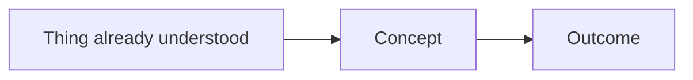

# Capture Concept

Capture unfamiliar concepts by preparing high-quality `concept_content`, then hand it to `obsidian-append` for every vault mutation.

This skill owns explanation quality. The writer skill owns file placement, duplicate checks, frontmatter, tags, glossary tables, backlinks, verification, and reporting.

## Required Companions

1. Use the available Obsidian Markdown capability before drafting content that will be saved. In Codex, invoke `obsidian-markdown`; in another harness, use the equivalent Obsidian-flavored Markdown guidance.
2. Invoke `obsidian-append` for all vault writes. Do not directly create, append, or update vault files from this skill.

## Workflow

1. Identify the concept and scope from the conversation. If the concept is ambiguous, ask one concise question; otherwise proceed.
2. Ground the explanation in primary sources when possible. For web/API/library/cloud concepts, verify the official docs or use the official link provided by the user.
3. Draft `concept_content`: mental model, concrete example, diagram when helpful, official docs, gotchas, and related concepts.
4. Choose handoff hints for the writer:
   - **`mode_hint: "glossary"`** for narrow, definition-like concepts that fit in about one screen.
   - **`mode_hint: "standalone"`** for concepts with lifecycle, variants, gotchas, examples, or diagrams worth revisiting.
   - **`mode_hint: "update"`** when the conversation clearly extends an existing concept note.
   - **`target_hint`** only when the target glossary or note is obvious from the user's wording.
5. Invoke `obsidian-append` with the prepared content:

```text
Skill("obsidian-append", args={
  concept_name: "<canonical concept name>",
  concept_content: "<drafted Obsidian-friendly markdown>",
  source: "<conversation or supplied source attribution>",
  mode_hint: "glossary" | "standalone" | "update",
  target_hint: "<filename without .md>" | null,
  no_interactive: false
})
```

6. If the writer reports ambiguous placement or duplicate matches, let the writer's prompt drive the user decision.
7. Reply with 1-3 sentences and a link to the note or glossary entry returned by the writer; do not rehash the artifact.

## Draft Shape

For standalone-style `concept_content`, do not include YAML frontmatter, tags, table rows, or backlink-maintenance sections. The writer owns those.

````markdown
# Concept Name

> [!summary]
> Short mental model for the concept.

## Diagram



## Mental Model

Short explanation of how to think about it.

> [!tip] Python analogy
> Optional analogy for Marcus's Python background when it clarifies the idea.

## Concrete Example

Small request, code, command, or workflow that makes the concept real.

## Official Docs

- [Source label](https://example.com)

## Gotchas

- One or two points that would prevent a wrong mental model.

## Related

- [[Related Concept]]
````

For glossary-style `concept_content`, keep the draft compact and self-contained:

````markdown
### Concept Name

**One-line definition.**

```text
small ASCII diagram if Mermaid would be too heavy
```

Mental model: ...

Example: ...

Official docs: [Source label](https://example.com)
````

## Explanation Rules

- Lead with the mental model, not the formal definition; for visual topics, place the diagram before explanatory prose.
- Include one concrete example before abstract edge cases.
- Use Mermaid diagrams for flows, architecture, and lifecycles; use ASCII diagrams for tiny mechanics.
- Use Marcus's vault conventions when known. Lead with Mermaid/SVG for visual topics, and use the palette `#4a9eff`, `#2ecc71`, `#e74c3c`, `#e67e22`, `#95a5a6` when styling Mermaid diagrams.
- Prefer primary sources: MDN, WHATWG, RFCs, official library/framework docs, and vendor docs. Blog posts may support the explanation, but should not be the main authority.
- Summarize official docs in your own words. Quote only short excerpts when necessary.
- Mention uncertainty when official docs are unavailable or when source quality is weak.

## Handoff Boundary

- Do not search for final insertion positions, edit glossary tables, or manage reverse backlinks here.
- Do not add standalone-note frontmatter; `obsidian-append` owns frontmatter and tags.
- Do not silently choose among duplicate existing notes; delegate duplicate handling to the writer.
- Keep `concept_content` portable enough for the writer to place as a glossary entry, standalone note, or update.
