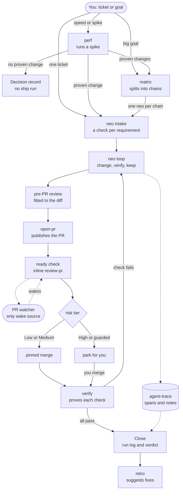

# How the neo suite works

The neo suite takes written work to a merged and verified result while you are away. You answer one intake message at the start. You read one message with every parked item at the end.
The [vocabulary](neo-vocabulary.md) defines the terms, such as chain, PR brief, and work ID.

`matrix` writes one PR brief for each PR in a chain. `perf` hands a proven change on only after you confirm, and its ticket carries the hand-off. The pre-PR review runs no reviewer when an existing check covers the diff, and one open review for new check code. `neo` publishes with `open-pr --no-review`. The PR watcher is `review-pr`'s `scripts/watch-pr.sh`, one for each open PR, and a parked PR keeps its watcher. Under a merge grant, `/matrix` queues the pinned merge.

| Part | Kind | Its job in a run |
| --- | --- | --- |
| `neo` | Skill | Runs one ticket or one `matrix` chain, from intake to close. |
| `matrix` | Skill | Splits a large goal across several `neo` workers, asks for each grant once at intake, batches decisions for you, and closes the ticket. It never writes code. |
| `perf` | Skill | Runs a spike: it proves or refutes each idea by experiment, under the proof rule of its method. Its ticket carries a fixed hand-off for `neo` or `matrix`: baselines by run ID, methods, traps, dropped ideas, and open decisions. It never ships code. |
| `open-pr` | Skill | Publishes each change as a PR. For a `neo` PR it runs with `--no-review` and starts no follow-up, so `neo` is the only writer on the branch. |
| `review-pr` | Skill | Gives the procedure that takes a PR through review comments and required CI to ready. `neo` follows it inline. Its PR watcher, `scripts/watch-pr.sh`, wakes the run. |
| `verify` | Skill | Proves each ticket check on the merged result, with evidence. |
| `retro` | Skill | Reads finished runs, saves a report, finds patterns across the last N reports, and suggests fixes to skills and tools. |
| `agent-trace` | Tool | Records the run as spans and friction notes, and prints the run log. |
| `auth-helper` | Tool | Checks at intake that each login will last for the whole run. |

The hard limits apply at every step:

- Guarded changes wait for you: data, migrations, infra, auth, secrets, and CI workflows.
- A merge uses only the reviewed commit.
- Spacelift is read-only.
- Done means every ticket check passes on the merged result, not that the PR merged.

## Release notes

When a version changes a neo suite part, its release notes get a change map, placed after the first paragraph.
Use the format of `open-pr`'s [change map reference](open-pr/references/change-map.md): base the map on the diagram above, colour each part as new, changed, or unchanged since the last version, and check it with `open-pr`'s `scripts/check-mermaid.sh`.
GitHub release pages do not render Mermaid. Render the map to a PNG with `npx -p @mermaid-js/mermaid-cli mmdc -i <file>.mmd -o change-map.png -s 2 -b white`, upload it with `gh release upload <tag> change-map.png`, and embed it as an image from `https://github.com/sucramual/mp/releases/download/<tag>/change-map.png`.
The map goes in the release notes, not in this file, because its colours describe one version only.

## neo and rogue

`neo` is a slim version of `rogue`, kept beside it so the two can be compared on real tickets.
`neo` fires on "/neo", "neo this ticket", or "run this ticket end to end without me", and not on a plain request to open a PR.
